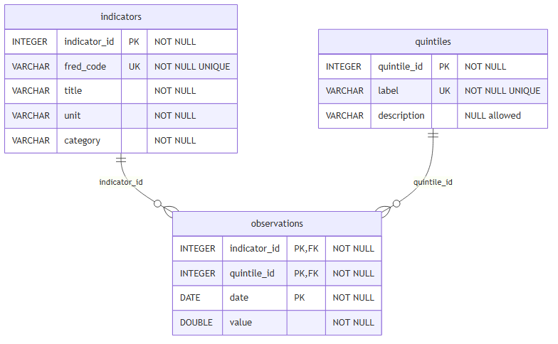

# Healthcare Affordability in the United States — Group Project

This project investigates how healthcare expenditures have evolved relative to personal income, and assesses whether healthcare has become less affordable over time in the United States.

We retrieve economic time series from the [FRED API](https://fred.stlouisfed.org/), store them in a relational DuckDB database, and analyze them through a reusable Python class.

---
## Authors
Lara Mileto https://github.com/LaraMileto
Joao Matteo Pisaturo https://github.com/jmp1909
Mathis Clement https://github.com/Mclement197
Michele Zecchin https://github.com/zektronix
Erwan Rollin https://github.com/erwanroo

## Research Question

> **Has healthcare become less affordable for US households over time?**

We track healthcare spending, income after tax, total consumer expenditure, and medical price indices across income quintiles and over time to measure affordability trends.

### Data Series

All series are sourced from FRED (Federal Reserve Economic Data, St. Louis Fed):

| Series ID | Description | Unit |
|---|---|---|
| `CXUHEALTHLB0102M` – `CXUHEALTHLB0106M` | Healthcare Spending by income quintile | USD |
| `CXUINCAFTTXLB0102M` – `CXUINCAFTTXLB0106M` | Income After Tax by income quintile | USD |
| `CXUTOTALEXPLB0102M` – `CXUTOTALEXPLB0106M` | Total Expenditure by income quintile | USD |
| `CPIAUCSL` | CPI — All Items | Index |
| `CPIMEDSL` | CPI — Medical Care | Index |
| `MEPAINUSA646N` | Median Personal Income | USD |

Income quintile suffixes: `02` = lowest, `03` = second, `04` = middle, `05` = fourth, `06` = highest. Note that `CPIAUCSL` and `CPIMEDSL` are urban series, not US-wide since those were not available.

---

## Repository Structure

```
project-repo/
├── .gitignore
├── README.md
├── pyproject.toml
├── uv.lock
│
├── data/
│   ├── build_fred.py       ← retrieves data from FRED and builds the database
│   ├── er_diagram.png      ← entity-relationship diagram of the database schema
│   └── fred.db             ← generated DuckDB database (committed for reproducibility)
│
├── src/
│   └── your_class.py       ← Python analysis class
│
└── notebooks/
    ├── analysis.qmd        ← analysis handout (Quarto)
    ├── analysis.html       ← rendered analysis
    ├── user_guide.qmd      ← user guide (Quarto)
    └── user_guide.html     ← rendered user guide
```

---

## Requirements

### uv

This project uses `uv` for Python version management and dependency installation.

Install `uv`:

```bash
curl -LsSf https://astral.sh/uv/install.sh | sh
```

Verify:

```bash
uv --version
```

### Python 3.13

Install Python 3.13 via `uv`:

```bash
uv python install 3.13
```

Verify:

```bash
uv run python --version
```

---

## Environment Setup

From the repository root, install the project environment and all dependencies:

```bash
uv sync
```

This creates a local virtual environment and installs everything listed in `pyproject.toml`.

---

## API Key

This project requires a free FRED API key. Register at [fred.stlouisfed.org](https://fred.stlouisfed.org/docs/api/api_key.html).

Create a file named `sandbox.env` in the project root:

```env
API_KEY=your_fred_api_key_here
```

> **Important:** do not commit `sandbox.env`. It is listed in `.gitignore`.

The project loads it at runtime using `python-dotenv`:

```python
from dotenv import load_dotenv
import os

load_dotenv("sandbox.env")
fred_api_key = os.getenv("API_KEY")
```

---

## Database

The database (`data/fred.db`) is a local DuckDB file committed to the repository. No database server, host, or credentials are required.

To connect:

```python
import duckdb

con = duckdb.connect("data/fred.db")
```

The database is built once by running `data/build_fred.py`. After that, all analysis reads exclusively from `fred.db` — no further API calls are made.

To rebuild the database from scratch (requires a valid `sandbox.env`):

```bash
uv run python data/build_fred.py
```

### Database Schema



---

## Python Class

The analysis is built around the `HealthcareAffordabilityAnalyzer` class in `src/your_class.py`.

### Instantiation

```python
from src.your_class import HealthcareAffordabilityAnalyzer

analyzer = HealthcareAffordabilityAnalyzer("data/fred.db")
```

### Data Methods

| Method | Description |
|---|---|
| `list_indicators()` | Returns all available indicators in the database |
| `list_quintiles()` | Returns all income quintile groups |
| `load_observations(category, quintile, start_date, end_date)` | Loads raw observations with optional filters |
| `prepare_quintile_panel(start_date, end_date)` | Builds the household panel by date and quintile |
| `prepare_price_index_panel(start_date, end_date)` | Builds the CPI panel |
| `compute_affordability_ratio(start_date, end_date)` | Healthcare spending as % of income after tax |
| `compute_health_budget_share(start_date, end_date)` | Healthcare spending as % of total expenditure |
| `compute_affordability_gap(low_quintile, high_quintile, ...)` | Affordability gap between two quintiles |
| `compute_real_values(variable, cpi_type, ...)` | Deflates a nominal variable using CPI |
| `affordability_summary_table(start_date, end_date)` | Summary table of affordability changes over time |

### Visualization Methods

| Method | Description |
|---|---|
| `plot_healthcare_spending_by_quintile(...)` | Healthcare spending over time by quintile |
| `plot_income_by_quintile(...)` | Income after tax over time by quintile |
| `plot_affordability_ratio(...)` | Healthcare spending as % of income *(main research figure)* |
| `plot_health_budget_share(...)` | Healthcare as % of total expenditure |
| `plot_medical_vs_total_cpi(...)` | Medical CPI vs total CPI |
| `plot_affordability_gap(low_quintile, high_quintile, ...)` | Affordability gap between two quintiles |
| `plot_real_vs_nominal(variable, quintile, cpi_type, ...)` | Nominal vs real values for a variable and quintile |

Dates can be passed as `"YYYY-MM-DD"` strings or `datetime.date` objects. All filters are optional.

---

## Running the Analysis

Run any Python script through `uv run` to use the project's virtual environment:

```bash
uv run python path/to/script.py
```

### Rendering the Notebooks

Render a Quarto `.qmd` file to HTML after pointing Quarto to the project's virtual environment.

**macOS / Linux:**

```bash
export QUARTO_PYTHON=.venv/bin/python
quarto render ./notebooks/analysis.qmd
```

**Windows PowerShell:**

```powershell
$env:QUARTO_PYTHON = ".venv\Scripts\python.exe"
quarto render .\notebooks\analysis.qmd
```

---

## Code Quality

This project uses `ruff` for formatting and linting.

```bash
# Format
uv run ruff format .

# Lint
uv run ruff check .

# Auto-fix
uv run ruff check . --fix
```

---

## Recommended Workflow

1. Install Python 3.13 with `uv python install 3.13`
2. Run `uv sync` to install dependencies
3. Create `sandbox.env` with your FRED `API_KEY`
4. The database `data/fred.db` is already committed — no need to rebuild it
5. Run scripts with `uv run python ...`
6. Render notebooks with `quarto render`
7. Format and lint with `ruff` before committing

---

## Useful Links

- [FRED API documentation](https://fred.stlouisfed.org/docs/api/fred/)
- [pyfredapi Python client](https://pyfredapi.readthedocs.io/en/latest/)
- [DuckDB documentation](https://duckdb.org/docs/)
- [uv documentation](https://docs.astral.sh/uv/)
- [Quarto documentation](https://quarto.org/docs/guide/)