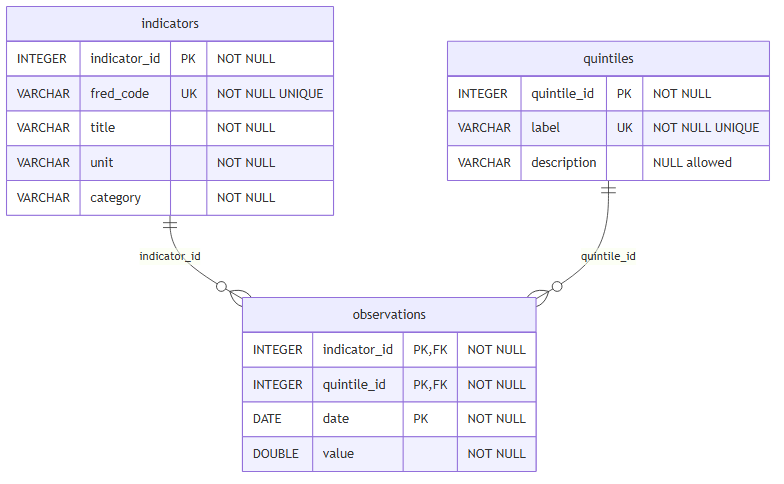

```{python}
#| echo: false
import sys
import matplotlib.pyplot as plt
from pathlib import Path

from dotenv import load_dotenv

PROJECT_ROOT = Path.cwd()

# If Quarto runs from inside the notebooks folder, go one level up
if PROJECT_ROOT.name == "notebooks":
    PROJECT_ROOT = PROJECT_ROOT.parent

sys.path.insert(0, str(PROJECT_ROOT))

from src.your_class import HealthcareAffordabilityAnalyzer

DB_PATH = PROJECT_ROOT / "data" / "fred.db"

analyzer = HealthcareAffordabilityAnalyzer(db_path=DB_PATH)
```

## 1. Research Question
Our research question is: How have urban healthcare expenditures evolved relative to personal income, and has healthcare become less affordable over time in the U.S?
We studied affordability by comparing healthcare spending with two household resources: income after tax and total expenditure. The main metric is healthcare spending as a percentage of income after tax, where a higher value means that healthcare absorbs a larger share of household income and is therefore less affordable.

The analysis is separated by income quintile. This is important because the same dollar increase in healthcare spending can have very different effects for low-income and high-income households.

The main analysis uses the period 1984–2023, which is the longest available sample for all indicators. The 2024 observations are excluded because they produced incomplete ratio values for the affordability calculation. Using 2023 as the final year keeps the table, figures, and discussion consistent. 

Two important notes on scope. First, the quintile-specific spending and income series covers the full U.S. civilian non-institutionalized population (urban and rural). Second, the CPI series used in this analysis reflect prices faced by urban consumers, who account for a significant majority of the U.S. population. The analysis should be seen as a national-level, with the price-comparison results carrying a mild urban tilt.

## 2. Data and Database Structure
The project uses FRED time series on healthcare spending, personal income after tax, total expenditure, total CPI, medical CPI. The quintile-specific series are stored together with metadata in a relational DuckDB database. 

The database has three main tables:

- `indicators`: metadata for each FRED series;
- `quintiles`: income quintile labels and descriptions;
- `observations`: the observed values by indicator, quintile, and date.

{#fig-er width="75%" fig-align="center"}


## 3. Findings: Figures and Summary Tables
The following outputs are generated from the `HealthcareAffordabilityAnalyzer` class. We present only the outputs that best answer the research question.

### Summary table: healthcare affordability by quintile

The first table summarizes how healthcare spending as a percentage of after-tax income changed over the available sample period. A positive change means that healthcare became less affordable within that quintile over time. However, the level of the ratio is also important: a quintile can have a smaller increase but still face a much higher overall burden.

```{python}
#| label: tbl-affordability-summary
#| echo: false
#| tbl-cap: "Change in healthcare spending as a percentage of after-tax income by quintile."

affordability_summary = analyzer.affordability_summary_table(
    metric="affordability_ratio",
    start_date="1984-01-01",
    end_date="2023-01-01"
)

affordability_summary = affordability_summary.sort_values("quintile").reset_index(drop=True)

affordability_summary = affordability_summary.rename(
    columns={
        "quintile": "Quintile",
        "start_date": "Start",
        "end_date": "End",
        "start_value": "Start value (%)",
        "end_value": "End value (%)",
        "change_pp": "Change (pp)",
        "percent_change": "Change (%)",
        "mean": "Mean",
        "std": "SD"
    }
)

affordability_summary
```

### Affordability ratio

The central measure of this analysis is healthcare spending as a percentage of income after tax. A higher value means that households spend a larger part of their income on healthcare.

```{python}
#| label: fig-affordability-ratio
#| echo: false
#| fig-cap: "Healthcare spending as a percentage of income after tax by income quintile."
#| fig-width: 8
#| fig-height: 4

_ = analyzer.plot_affordability_ratio(start_date="1984-01-01", end_date="2023-01-01")
```

### Healthcare as share of total expenditure

The next figure checks the same question from a second perspective: healthcare spending as a percentage of total household expenditure. This shows whether healthcare has taken up a larger part of households' overall spending basket.

```{python}
#| label: fig-budget-share
#| echo: false
#| fig-cap: "Healthcare spending as a percentage of total household expenditure by income quintile."
#| fig-width: 8
#| fig-height: 4

_ = analyzer.plot_health_budget_share(start_date="1984-01-01",
    end_date="2023-01-01")
```

### Medical CPI compared with total CPI

Finally, we compare medical CPI with total CPI. This helps to understand whether medical prices increased faster than the general price level.

```{python}
#| label: fig-cpi
#| echo: false
#| fig-cap: "Medical CPI compared with total CPI."
#| fig-width: 8
#| fig-height: 4

_ = analyzer.plot_medical_vs_total_cpi(
    start_date="1984-01-01",
    end_date="2023-01-01"
)
```


## 4. Discussion 
### Interpretation of results 
The summary table and the affordability-ratio figure show two important results. First, healthcare spending absorbs a much larger share of after-tax income for lower-income households than for higher-income households. In 2023, the lowest income quintile spent 21.88% of after-tax income on healthcare, compared with only 4.56% for the highest income quintile. This means that the healthcare burden is clearly unequal across the income distribution.

Second, healthcare affordability worsened for all quintiles between 1984 and 2023, because the affordability ratio increased in every income group. The increase was largest in absolute percentage-point terms for Q4, where the ratio rose from 4.23% to 6.70%, an increase of 2.47 percentage points. Q3 and Q2 also experienced clear increases, while Q1 rose from 20.47% to 21.88%.

In proportional terms, however, the ranking changes: Q4 and Q5 both saw their affordability ratios grow by more than 55% over the period, while Q1's grew by only about 7%. This combination of Q1 holding the highest level but the smallest proportional change, with Q4 and Q5 the opposite is consistent with public coverage expansions (Medicaid, ACA) partly insulating low-income households from medical price growth, while higher-income households remained fully exposed through private insurance and out-of-pocket spending. A less optimistic reading for Q1 is that low-income households ration care when prices rise; the data shows expenditure, not unmet need, and cannot separate the two mechanisms.

The figure also shows that the affordability ratio for Q1 fluctuated strongly over time. It declined during parts of the 1990s and 2000s, but increased again after the early 2010s. For the other quintiles, the affordability ratio was more stable, and the increase appears more gradual, especially from around 2010 onward. Overall, the main finding is therefore not simply that healthcare spending increased, but that healthcare remained structurally much less affordable for low-income households than for high-income households.


The healthcare budget-share figure confirms that healthcare became a larger part of household expenditure over time. For all income quintiles, the share of total expenditure spent on healthcare increased between the mid-1980s and the early 2020s. This means that healthcare did not only rise relative to income; it also became more important within the overall household spending basket.

The expenditure-share figure tells a partially different story from the affordability ratio. Q1 and Q2 converge around 2014 at roughly 10% of total expenditure, with Q3 closing most of its earlier gap with Q4 over the same period. The most striking pattern is Q1's sharp acceleration after 2013: its healthcare share held steady around 7–8% for nearly three decades, then climbed to about 10% in under a decade: precisely the post-ACA period in which Q1's affordability ratio changed little. The two metrics diverge because they use different denominators (income vs. total expenditure), and for low-income households transfers and tax credits affect income more directly than consumption. The convergence of Q1, Q2, and Q3 likely reflects parallel trends rather than a single cause: Q1's healthcare is partly sustained by public coverage, while Q2–Q4 face rising premiums and out-of-pocket costs given the rising cost of healthcare compared to the larger basket of goods and services. Q5 stands apart at 6–7%, suggesting higher-income households have either better coverage or enough budgetary slack that healthcare does not dominate their spending.

The CPI figure gives useful background for these patterns. Medical CPI increased much faster than total CPI over the long run. This means that medical care prices rose more strongly than the general price level. This helps explain why healthcare spending became a larger burden for households: healthcare costs were affected not only by general inflation, but also by stronger price growth in the medical sector.

Taken together, these two figures strengthen the main finding. Healthcare affordability worsened not only because nominal spending increased, but also because healthcare became a larger part of household budgets while medical prices grew faster than overall consumer prices. The burden remains especially relevant for lower-income households, because they have less income available to absorb these increases.

### Weaknesses of the analysis
The analysis has some limitations. First, it is mainly descriptive and does not prove that medical prices, income changes, or any specific policy caused the observed affordability patterns. The figures show how healthcare spending, income, expenditure shares, and CPI evolved together, but they do not identify causal effects. Second, the analysis uses income quintiles, which are useful for comparing broad groups but hide differences within each quintile. For example, households at the bottom of Q1 may face a much heavier burden than households closer to the top of Q1. Third, the data measure average spending by quintile, so the analysis does not capture individual-level differences such as age, insurance coverage, health status, family size, or regional variation. Finally, the 2024 observations were excluded from the main summary table because they produced incomplete ratio values, so the most recent year is not fully interpreted.

### Future research directions
Future research could extend the analysis in several ways. The most promising direction is to disaggregate healthcare spending into subcategories: insurance premiums, medical services, prescription drugs, and out-of-pocket payments to identify which component drives the affordability burden. A second extension would incorporate household characteristics beyond income (age, insurance status, family composition) to better identify which households within each quintile are most exposed. A third direction would move from description to inference, formally testing whether medical CPI growth is systematically associated with affordability increases across income groups. A fourth would link specific policy episodes, such as the ACA rollout or Medicaid expansions, to changes in the affordability ratio to assess whether institutional interventions visibly reduce the burden on lower quintiles.


## 5. Conclusion
Overall, the analysis shows that healthcare affordability in the United States differs strongly across income groups. Healthcare spending increased over time for all quintiles, but the burden is much heavier for lower-income households when measured relative to after-tax income. In 2023, the lowest income quintile still spent a far larger share of income on healthcare than the highest income quintile, even though higher-income households spend more in absolute dollar terms. The expenditure-share results support the same general pattern, showing that healthcare has become a more important part of household budgets. The comparison between medical CPI and total CPI also shows that medical prices rose faster than the general price level over the observed period. Therefore, the main answer to the research question is that healthcare remained least affordable for lower-income households and became less affordable over time across all quintiles, although the size of the increase differed across groups. The key insight is that affordability should not be judged only by nominal spending, but by how large the healthcare burden is relative to household resources.